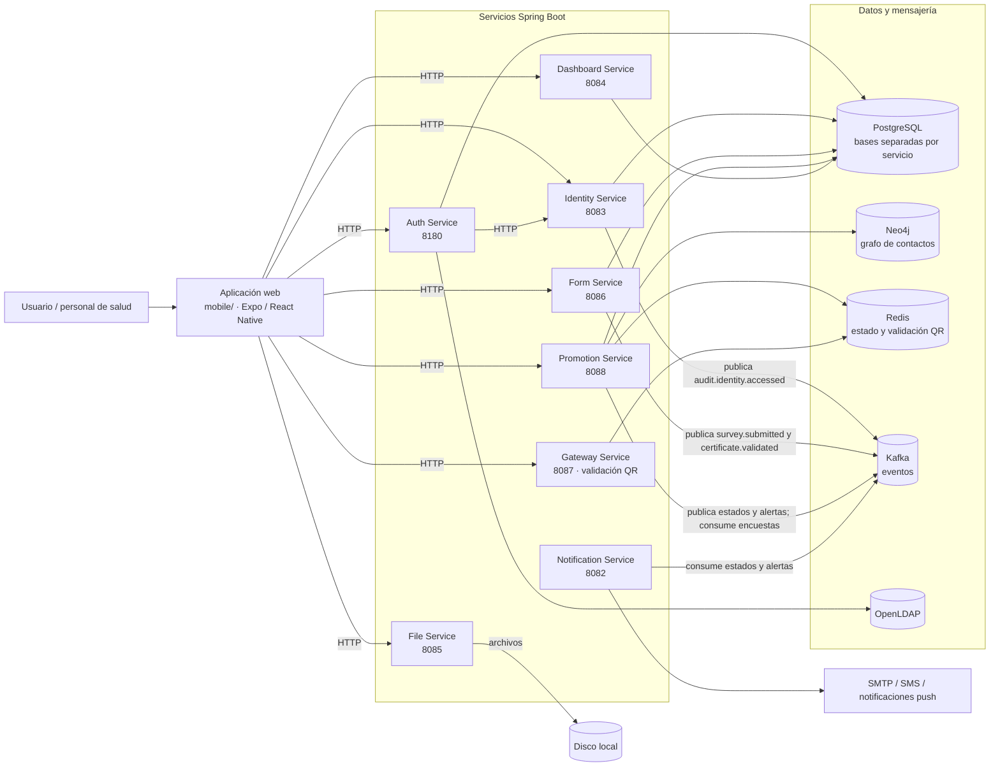

# Documentación de CircleGuard

Este es el punto de entrada a la documentación técnica y operativa de CircleGuard. El
[`README.md`](../README.md) de la raíz conserva la presentación general del proyecto (visión,
misión y roadmap); este documento explica el estado real del código, cómo ejecutarlo, cómo se
prueba y cómo se construye y despliega.

| Enlace | Contenido |
|--------|-----------|
| [Backlog en Jira](https://circleguard-msvi.atlassian.net/jira/software/projects/SCRUM/boards/1/backlog?selectedIssue=SCRUM-37) | Historias de usuario, tablero y seguimiento del equipo. |
| [Librería de pipeline](https://github.com/isabellacv1/circleguard-jenkins-library) | Pipeline compartido de Jenkins (`circleguard-pipeline-library`). |

## Cómo leer esta documentación

| Si necesitas… | Empieza por… |
|---------------|--------------|
| Entender el sistema y sus decisiones | [`arquitectura/contexto-tecnico.md`](arquitectura/contexto-tecnico.md) |
| Ver los componentes y sus dependencias | [`arquitectura/arquitectura.md`](arquitectura/arquitectura.md) |
| Saber cómo corre Jenkins y qué hace cada build | [`operaciones/pipeline.md`](operaciones/pipeline.md) |
| Construir, publicar o desplegar imágenes | [`operaciones/despliegue.md`](operaciones/despliegue.md) |
| Entender versiones, tags y releases | [`operaciones/versionado.md`](operaciones/versionado.md) y [`operaciones/release-process.md`](operaciones/release-process.md) |
| Revisar la estrategia y evidencia de pruebas | [`operaciones/pruebas.md`](operaciones/pruebas.md) |
| Validar la infraestructura AWS | [`operaciones/infraestructura.md`](operaciones/infraestructura.md) |
| Escribir commits y Pull Requests | [`CONTRIBUTING.md`](CONTRIBUTING.md) |
| Revisar la entrega de cada sprint | [`agil/`](agil/) |

## Estado del proyecto

- **MVP funcional:** los cinco servicios núcleo y la app web se ejecutan con Docker Compose.
- **CI/CD:** Jenkins construye, prueba, analiza con SonarQube, publica imágenes en Nexus y
  despliega en AWS.
- **Versionado automático:** semantic-release calcula la versión a partir de los commits
  convencionales y publica tags y GitHub Releases.
- **Despliegue y promoción:** `dev` se despliega automáticamente; `stage` se promueve tras
  las pruebas E2E y `prod` requiere aprobación manual.
- **Notificaciones:** cuando un build falla, la librería envía un mensaje a Discord con el
  job, el build, la rama, el commit y la URL.

## Arquitectura

CircleGuard es un monorepo Gradle (Kotlin DSL) con microservicios Spring Boot, una app
Expo/React Native y comunicación asíncrona por Kafka. El análisis detallado de módulos,
flujos, persistencia, seguridad y riesgos está en
[`arquitectura/contexto-tecnico.md`](arquitectura/contexto-tecnico.md).

### Diagrama de arquitectura



El diagrama completo, con las dependencias de datos y mensajería, está en
[`arquitectura/arquitectura.md`](arquitectura/arquitectura.md).

| Componente | Puerto | Responsabilidad | ¿Se despliega? |
|------------|--------|-----------------|----------------|
| `auth-service` | 8180 | Login LDAP/local, JWT, QR de acceso | Sí |
| `identity-service` | 8083 | Vault de identidades y anonimización | Sí |
| `promotion-service` | 8088 | Grafo de contactos y propagación de estados | Sí |
| `form-service` | 8086 | Cuestionarios y encuestas de salud | Sí |
| `gateway-service` | 8087 | Validación del QR en portería | Sí |
| `web` (Expo) | 8081 | Cliente web servido por nginx | Sí |
| `notification-service` | 8082 | Notificaciones multicanal | No |
| `dashboard-service` | 8084 | Analítica con k-anonimato | No |
| `file-service` | 8085 | Almacenamiento de archivos | No |

> El despliegue actual cubre los cinco servicios núcleo y la app web. `notification`,
> `dashboard` y `file` existen en el monorepo.

## Stack

| Capa | Tecnología |
|------|------------|
| Backend | Java 21, Spring Boot 3.2.4, Gradle Kotlin DSL |
| Datos | PostgreSQL 16, Neo4j 5.26, Redis 7.2 |
| Mensajería | Apache Kafka 7.6 (imagen Confluent) |
| Directorio | OpenLDAP (`circleguard.edu`) |
| Cliente | Expo / React Native / TypeScript |
| Contenedores | Docker y Docker Compose |
| CI/CD | Jenkins, SonarQube, Nexus, GitHub Actions |
| Versionado | semantic-release + Conventional Commits |

## Ejecución local

Solo se necesita Docker con Compose v2. El comando levanta el middleware, los cinco
servicios núcleo y la app web:

```bash
docker compose -f docker-compose.dev.yml -f docker-compose.app.yml up -d --build
```

| Recurso | URL |
|---------|-----|
| App web | http://localhost:8081 |
| Auth | http://localhost:8180 |
| Identity | http://localhost:8083 |
| Form | http://localhost:8086 |
| Gateway | http://localhost:8087 |
| Promotion | http://localhost:8088 |
| Neo4j Browser | http://localhost:7474 |

Usuarios de prueba (contraseña `password`): `super_admin`, `staff_guard`, `health_user`.

Para desarrollo con Gradle o con la app Expo, consulta las secciones de ejecución de
[`arquitectura/contexto-tecnico.md`](arquitectura/contexto-tecnico.md).

## Reproducir el entorno completo

El apartado anterior levanta el entorno local de desarrollo. Para reproducir el entorno del
taller (CI/CD y los tres ambientes) desde cero:

### 1. Requisitos

- Acceso SSH a las instancias ya creadas `cg-devops`, `cg-sonarqube`, `cg-dev`, `cg-stage` y
  `cg-prod`.
- Llave SSH en `~/.ssh/cg-devops-key.pem` (o la ruta que definas en `CI_SSH_KEY`).
- Docker y Docker Compose v2 en las instancias.
- AWS CLI v2 configurado con permisos de lectura para validar las instancias.
- Git y acceso al repositorio.

### 2. Configurar credenciales de infraestructura

```bash
cp infra/config-as-code/.env.example infra/config-as-code/.env
$EDITOR infra/config-as-code/.env
```

Completa hosts, URLs de Jenkins, SonarQube y Nexus, y las credenciales. El archivo `.env`
está en `.gitignore` y no se versiona.

### 3. Levantar Jenkins, Nexus y SonarQube

```bash
./infra/bootstrap-all.sh --dry-run
./infra/bootstrap-all.sh
```

El script valida el acceso SSH, asegura Docker, levanta Jenkins (`8080`), Nexus (`8081`) y
SonarQube (`9092`), espera los healthchecks y aplica la configuración de SonarQube. Es
idempotente: se puede ejecutar varias veces sin efectos secundarios. Las opciones y el
detalle están en [`../infra/config-as-code/README.md`](../infra/config-as-code/README.md).

### 4. Configurar Jenkins

```bash
./infra/config-as-code/jenkins/configure-jenkins.sh
```

Crea las credenciales `nexus-credential`, `sonarqube-token`, `discord-webhook-url` y
`git-credential`. Las credenciales SSH de despliegue (`ssh-deploy-dev`, `ssh-deploy-stage` y
`ssh-deploy-prod`) se crean manualmente por seguridad. Después crea o reescanea el job
multibranch `circleguard` desde
[`../infra/jenkins/jobs/circleguard.xml`](../infra/jenkins/jobs/circleguard.xml) y configura
el webhook de GitHub como se explica en [`operaciones/pipeline.md`](operaciones/pipeline.md).

### 5. Desplegar y validar

Haz push a `dev` o ejecuta el job manualmente. El pipeline publica las imágenes, despliega en
`dev`, ejecuta smoke tests y E2E, y promueve a `stage`; `prod` requiere aprobación manual.
Para validar la infraestructura:

```bash
./scripts/check-infrastructure.sh
```

| Entorno | URL de la app web |
|---------|-------------------|
| `dev` | http://54.83.254.142:8081 |
| `stage` | http://184.192.198.69:8081 |
| `prod` | http://98.92.231.157:8081 |

Los hosts, puertos y el flujo de despliegue están en
[`operaciones/despliegue.md`](operaciones/despliegue.md); la validación de las instancias y
servicios, en [`operaciones/infraestructura.md`](operaciones/infraestructura.md). El manual
de operaciones completo es la sección [`operaciones/`](operaciones/).

## Pruebas

```bash
./gradlew test                 # unitarias
./gradlew integrationTest      # integración con Testcontainers
cd tests/e2e-playwright && npm ci && npx playwright install chromium && npx playwright test
```

La estrategia, la cobertura, los flujos cubiertos y los hallazgos están en
[`operaciones/pruebas.md`](operaciones/pruebas.md).

## CI/CD y despliegue

```
push a dev ─► Build ─► Tests ─► Integración ─► SonarQube ─► Publicar imágenes en Nexus
        └─► Deploy dev ─► Verificar ─► Smoke tests ─► E2E
                                                          │
                                                          ▼
                                                   Promover a stage (automático)
                                                          │
                                                          ▼
                                                   Promover a prod (aprobación manual)
```

- Cómo funciona Jenkins, el job multibranch y qué ejecuta cada etapa:
  [`operaciones/pipeline.md`](operaciones/pipeline.md).
- Dockerfiles, registro Nexus, entornos, despliegue, verificación, promoción y rollback:
  [`operaciones/despliegue.md`](operaciones/despliegue.md).
- Cálculo de versión, tags y relación con las imágenes:
  [`operaciones/versionado.md`](operaciones/versionado.md).
- Notas de release y GitHub Releases:
  [`operaciones/release-process.md`](operaciones/release-process.md).

## Índice de documentación

| Documento | Contenido |
|-----------|-----------|
| [`arquitectura/arquitectura.md`](arquitectura/arquitectura.md) | Diagrama de componentes y dependencias de datos y mensajería. |
| [`arquitectura/contexto-tecnico.md`](arquitectura/contexto-tecnico.md) | Análisis técnico: módulos, flujos, persistencia, seguridad, riesgos y bugs corregidos. |
| [`operaciones/pipeline.md`](operaciones/pipeline.md) | Jenkins, etapas del pipeline y ejecuciones. |
| [`operaciones/despliegue.md`](operaciones/despliegue.md) | Dockerfiles, Nexus, entornos, promoción y verificación. |
| [`operaciones/versionado.md`](operaciones/versionado.md) | semantic-release, tags y versiones de imagen. |
| [`operaciones/release-process.md`](operaciones/release-process.md) | Release notes y GitHub Releases. |
| [`operaciones/pruebas.md`](operaciones/pruebas.md) | Pruebas unitarias, de integración y E2E. |
| [`operaciones/infraestructura.md`](operaciones/infraestructura.md) | Validación de la infraestructura AWS. |
| [`CONTRIBUTING.md`](CONTRIBUTING.md) | Convención de commits y flujo de Pull Requests. |
| [`agil/iag_registro.md`](agil/iag_registro.md) | Plantilla de la bitácora de uso de IAG (Nivel 3). |
| [`agil/Circle Guard - Sprint 0.pdf`](<agil/Circle Guard - Sprint 0.pdf>) | Artefacto del Sprint 0. |

## Limitaciones conocidas

- No se usa Kubernetes: el despliegue es Docker Compose sobre instancias EC2.
- El rollback se apoyará en los tags semánticos; su implementación está a cargo de otro
  integrante del equipo.
- La creación de las instancias EC2 no está automatizada en este repositorio:
  `infra/bootstrap-all.sh` asume que `cg-devops`, `cg-sonarqube`, `cg-dev`, `cg-stage` y
  `cg-prod` ya existen y tienen Docker.
- Los servicios no exponen OpenAPI/Swagger.
- Los secretos de desarrollo (`jwt.secret`, `qr.secret`, `vault.secret`, credenciales de
  bases de datos) están en texto plano en el repositorio; son solo para desarrollo local.
- `notification`, `dashboard` y `file` no forman parte del despliegue actual.

## Estructura del repositorio

```
services/       8 microservicios Spring Boot
mobile/         app Expo / React Native
deploy/         compose de despliegue y variables por entorno
infra/          bootstrap y configuración de Jenkins, Nexus y SonarQube
tests/          pruebas E2E con Playwright
docs/           documentación del proyecto
scripts/        validación de infraestructura
```

## Contribución

Los mensajes de commit siguen [Conventional Commits](CONTRIBUTING.md). Los PR deben
fusionarse con *merge commit* o *rebase* para que semantic-release pueda calcular la versión.
