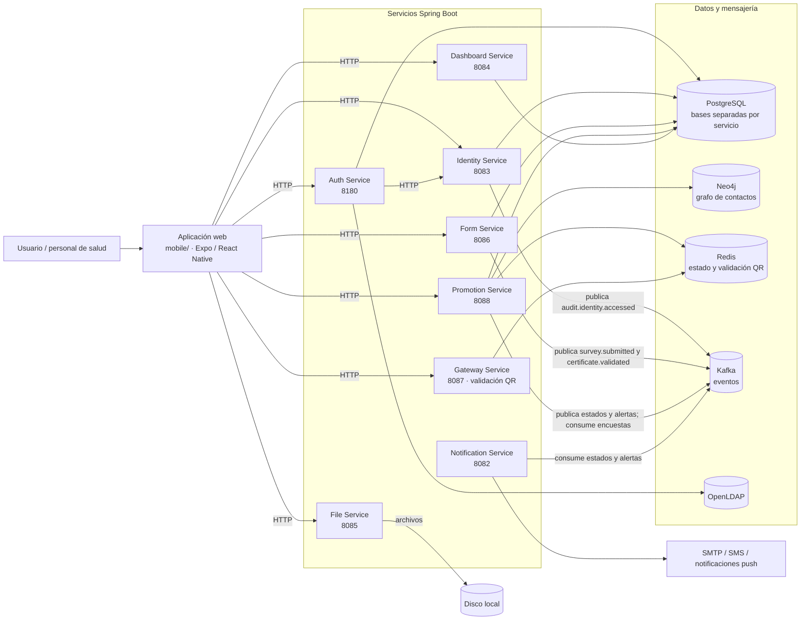

# Arquitectura de CircleGuard

El diagrama representa los servicios del proyecto, sus dependencias de datos y los
principales canales de comunicación. La aplicación web consume los servicios
directamente; `gateway-service` valida códigos QR de acceso y no actúa como API
Gateway.

En desarrollo, `docker-compose.dev.yml` define PostgreSQL, Neo4j, Redis, Kafka,
Zookeeper y OpenLDAP. `docker-compose.app.yml` incluye Auth, Identity, Promotion,
Form, Gateway y la aplicación web. Dashboard, File y Notification están en el
código, pero no forman parte de ese archivo Compose.
