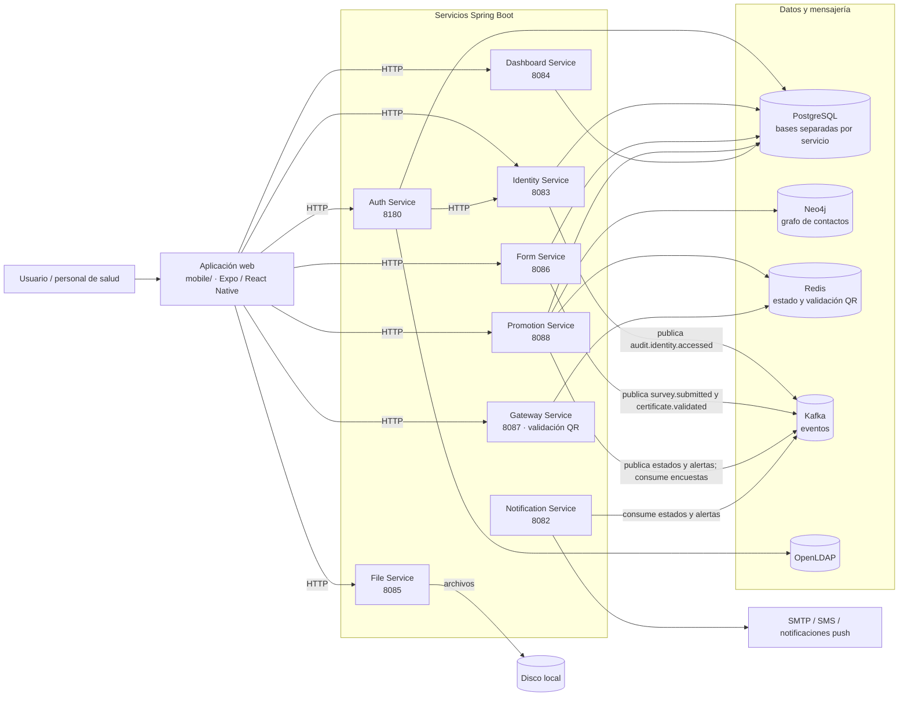

# Arquitectura de CircleGuard

El diagrama representa los servicios del proyecto, sus dependencias de datos y los
principales canales de comunicación. La aplicación web consume los servicios
directamente; `gateway-service` valida códigos QR de acceso y no actúa como API
Gateway.

En desarrollo, `docker-compose.dev.yml` define PostgreSQL, Neo4j, Redis, Kafka,
Zookeeper y OpenLDAP. `docker-compose.app.yml` incluye Auth, Identity, Promotion,
Form, Gateway, Notification, Dashboard, File y la aplicación web.

## Despliegue en Kubernetes

En `dev`, `stage` y `prod` los nueve componentes se despliegan en el namespace
`circleguard` mediante los overlays de `infra/k8s/overlays/<env>`. El pipeline
solo aplica recursos de aplicación (ConfigMaps, Deployments, Services, Ingress,
PVC y el HPA); la plataforma (namespaces, RBAC, cuotas, network policies y
observabilidad) se aplica por separado con una identidad administradora.

Cada deploy toma un snapshot de los 9 Deployments y 8 ConfigMaps antes de
`kubectl apply -k`. Si el apply, un rollout o la verificación de una promoción
fallan, se restauran solo los recursos cambiados y se comprueba la recuperación;
si no se puede garantizar, el build falla. No se revierten Secrets, volúmenes,
esquemas de base de datos ni estado de Kafka.

El gateway tiene un `HorizontalPodAutoscaler` de `autoscaling/v2` con rango
`1→2`; el componente elimina `spec.replicas` del Deployment para evitar que
Kustomize y el HPA peleen por el mismo campo. `maxSurge: 1` eleva el pico de
límites a `5750m/8192Mi`, dentro de la cuota de `6/8Gi` de dev/stage. La etapa
`Verify autoscaling` valida métricas, RBAC, cuota y capacidad real antes de
declarar sano el despliegue. Las promociones a stage/prod siguen desactivadas
hasta completar el preflight de credenciales, DNS/CORS/SMTP, imágenes y TLS.
