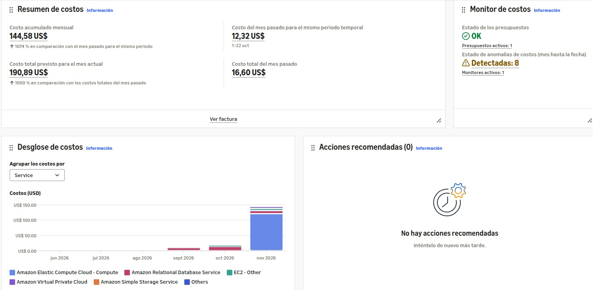
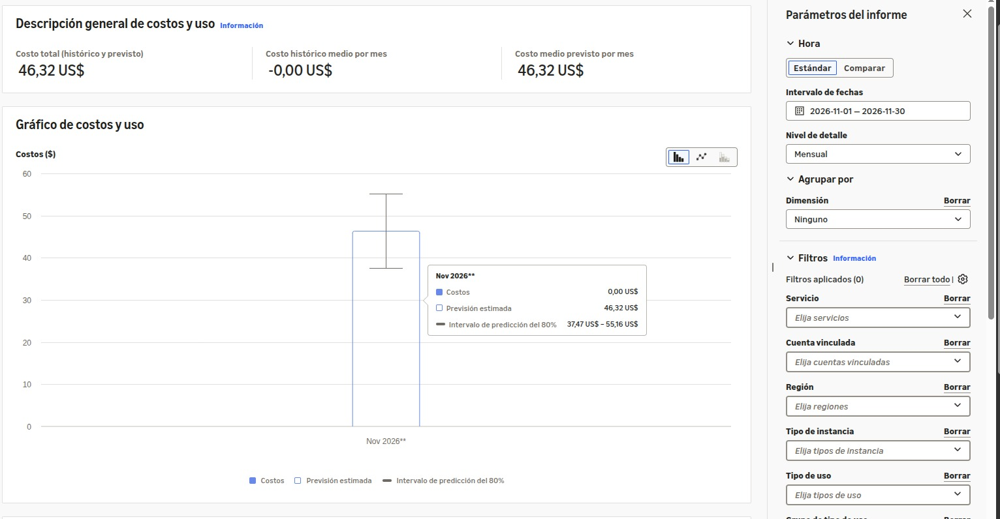

# Costos de infraestructura

Este documento presenta el costo **estimado** de la infraestructura de CircleGuard en AWS y
lo compara con el costo **real** facturado durante el proyecto (1 – 22 de noviembre de
2026).

## 1. Contexto

| Elemento | Valor |
|---|---|
| Proveedor | Amazon Web Services |
| Región | `us-east-1` (N. Virginia) |
| Cuenta | `718875641310` |
| Presupuesto del proyecto | USD 150 |
| Alertas de presupuesto | 50 %, 75 %, 90 % y 100 % (AWS Budgets) |
| Modelo de compra | On-Demand, Linux, sin instancias reservadas ni Savings Plans |

## 2. Inventario de recursos

### 2.1 Infraestructura del Sprint 1 (creada manualmente, HU-004)

| Recurso | Función | Tipo | Almacenamiento |
|---|---|---|---|
| `cg-devops` | Jenkins, Nexus | m7i-flex.large | 100 GB gp3 cifrado |
| `cg-sonarqube` | SonarQube | m7i-flex.large | 50 GB gp3 cifrado (supuesto) |
| `cg-dev` | Ambiente dev (Docker Compose) | m7i-flex.large | 50 GB gp3 cifrado |
| `cg-stage` | Ambiente stage (Docker Compose) | m7i-flex.large | 50 GB gp3 cifrado |
| `cg-prod` | Ambiente prod (Docker Compose) | m7i-flex.large | 50 GB gp3 cifrado |
| VPC `circleguard-vpc` | Red, 4 subredes, security groups | — | — |

### 2.2 Infraestructura del Sprint 2 (Terraform, HU-021 y HU-022)

| Recurso | Función | Tipo | Almacenamiento |
|---|---|---|---|
| `dev-server` | Clúster k3s dev | m7i-flex.large | 40 GB gp3 cifrado |
| `stage-server` | Clúster k3s stage | m7i-flex.large | 40 GB gp3 cifrado |
| `prod-server` | Clúster k3s prod (control plane) | m7i-flex.large | 50 GB gp3 cifrado |
| `prod-agent` | Clúster k3s prod (worker) | m7i-flex.large | 50 GB gp3 cifrado |
| Snapshots EBS (DLM) | Respaldo diario de los volúmenes raíz, retención de 7 | — | Incremental |
| Bucket S3 `circleguard-tfstate-…` | Estado remoto de Terraform | — | < 1 MB |
| Parameter Store | Token de unión de k3s en prod | Estándar | — |

Decisiones que reducen costo, tomadas en el diseño de la IaC:

- Sin Elastic IPs, NAT Gateway ni balanceadores de carga: el tráfico entra por la IP
  pública de cada nodo y el Ingress de k3s (Traefik).
- k3s en lugar de EKS: se evita el cargo del plano de control (USD 0,10/h por clúster,
  unos USD 73/mes cada uno, USD 219/mes por los tres ambientes).
- Solo prod tiene dos nodos. Dev y stage usan un único nodo.
- Locking nativo de Terraform en S3, sin tabla DynamoDB.
- Monitoreo detallado de EC2 desactivado (`monitoring = false`). La observabilidad se
  resuelve dentro del clúster con Prometheus, Grafana y Loki.
- Lifecycle en el bucket de estados: las versiones antiguas expiran a los 90 días.

## 3. Costo estimado

### 3.1 Precios unitarios (On-Demand, `us-east-1`)

| Concepto | Precio |
|---|---|
| EC2 `m7i-flex.large` (2 vCPU, 8 GiB) | USD 0,09576 / hora |
| EBS gp3 | USD 0,08 / GB-mes |
| Snapshots EBS | USD 0,05 / GB-mes (sobre bloques almacenados) |
| IPv4 pública | USD 0,005 / hora por dirección |
| S3 Standard | USD 0,023 / GB-mes |
| Parameter Store (estándar) | Sin costo |

Fuente: AWS Pricing Calculator y páginas de precios de EC2, EBS, VPC y S3,
consultadas en noviembre de 2026. Mes de referencia: 730 horas.

### 3.2 Costo mensual si todo estuviera encendido 24/7

| Concepto | Cálculo | USD / mes |
|---|---|---|
| EC2: 5 instancias del Sprint 1 | 5 × 0,09576 × 730 | 349,52 |
| EC2: 4 nodos k3s | 4 × 0,09576 × 730 | 279,62 |
| EBS gp3 | (300 + 180) GB × 0,08 | 38,40 |
| IPv4 públicas | 9 × 0,005 × 730 | 32,85 |
| Snapshots | ~60 GB almacenados × 0,05 | 3,00 |
| S3 + solicitudes | — | < 0,10 |
| **Total** | | **≈ 703,49** |

Encendida de forma permanente, esta infraestructura supera más de cuatro veces el
presupuesto de USD 150. Por eso el equipo acordó **apagar las instancias cuando no se
estaban usando**. Con las instancias detenidas solo se cobran los volúmenes EBS, los
snapshots y S3; las IPv4 públicas se liberan al detener una instancia sin Elastic IP.

### 3.3 Costo estimado del proyecto con el uso planeado

Supuesto: instancias encendidas en promedio **8 horas por día** durante los días en
que existieron.

| Concepto | Días | Cálculo | USD |
|---|---|---|---|
| EC2 Sprint 1 (5 instancias) | 19 (4 – 22 nov) | 5 × 0,09576 × 8 h × 19 | 72,78 |
| EC2 k3s (4 nodos) | 8 (15 – 22 nov) | 4 × 0,09576 × 8 h × 8 | 24,51 |
| IPv4 públicas (mientras están encendidas) | — | (5 × 8 × 19 + 4 × 8 × 8) h × 0,005 | 5,08 |
| EBS Sprint 1 (300 GB, 24/7) | 19 | 300 × 0,08 × 19/30 | 15,20 |
| EBS k3s (180 GB, 24/7) | 8 | 180 × 0,08 × 8/30 | 3,84 |
| Snapshots + S3 | — | — | 1,00 |
| **Total estimado** | | | **≈ 122,41** |

Con este supuesto el costo queda dentro del presupuesto (≈ 82 %), con un margen de
unos USD 28 para imprevistos. Cada hora diaria adicional de las 9 instancias suma
unos USD 12 al total del proyecto.

## 4. Costo real

### 4.1 Fuente

Los datos se tomaron de la consola de facturación de AWS el 22 de noviembre de 2026:

- **Billing → Resumen de costos**, agrupado por servicio (figura 1).
- **Cost Explorer**, noviembre de 2026, sin agrupación (figura 2).

*Figura 1. Resumen de costos y desglose por servicio en AWS Billing.*

*Figura 2. Cost Explorer: costo neto de noviembre y previsión del mes.*

### 4.2 Resultados

| Indicador | Valor |
|---|---|
| Costo acumulado del 1 al 22 de noviembre | **USD 144,58** |
| Porcentaje del presupuesto (USD 150) | **96,4 %** |
| Costo previsto para todo noviembre | USD 190,89 (127 % del presupuesto) |
| Costo del mismo periodo del mes anterior (1 – 22 oct) | USD 12,32 |
| Costo neto en Cost Explorer (después de descuentos) | USD 0,00 |
| Estado del presupuesto en AWS Budgets | OK |
| Anomalías de costo detectadas en el mes | 8 |

El costo neto de USD 0,00 en Cost Explorer frente a USD 144,58 de consumo indica que el
consumo de noviembre quedó cubierto por **créditos de AWS**: el equipo consumió unos
USD 145 en recursos, pero no tuvo pago efectivo.

Las 8 anomalías que reporta AWS corresponden al salto de consumo frente a octubre
(+1074 %), cuando se encendió la infraestructura del proyecto.

### 4.3 Comparación por servicio

La consola mostró el desglose por servicio solo en forma de gráfica, así que los valores
reales por servicio son **aproximados**, leídos de la figura 1. El total sí es exacto.

| Servicio | Estimado (USD) | Real aprox. (USD) | Diferencia |
|---|---|---|---|
| EC2 – Compute (instancias) | 97,29 | ≈ 121 | ≈ +24 |
| EC2 – Other (EBS, snapshots) | 20,04 | ≈ 6 | ≈ –14 |
| VPC (IPv4 públicas) | 5,08 | ≈ 5 | ≈ 0 |
| Amazon RDS | — | ≈ 8 | No es de CircleGuard (ver 5) |
| S3 y otros | < 0,10 | ≈ 4 | ≈ +4 |
| **Total** | **122,41** | **144,58** | **+22,17 (+18 %)** |

## 5. Análisis de la diferencia

El costo real superó el estimado en **USD 22,17 (18 %)**, pero se mantuvo dentro del
presupuesto. Las causas son:

1. **Más horas de uso de las previstas.** EC2 – Compute es el 84 % del costo total y quedó
   unos USD 24 por encima del estimado. Con el mismo cálculo de la sección 3.3, eso equivale
   a tener las instancias encendidas unas **10 horas diarias en promedio** en lugar de 8.
   Las semanas de mayor carga (pruebas de carga, despliegue en Kubernetes y cierre del
   Sprint 2) obligaron a dejar las máquinas encendidas más tiempo.
2. **Un servicio que no pertenece a CircleGuard.** La cuenta registra cargos de Amazon RDS
   desde septiembre, antes de iniciar el proyecto. CircleGuard no usa RDS: sus bases de
   datos corren dentro de las instancias. Sin esos ≈ USD 8, el costo atribuible a
   CircleGuard es de **≈ USD 137**, un 12 % sobre el estimado.
3. **Almacenamiento por debajo de lo estimado.** EC2 – Other (EBS y snapshots) costó menos
   de lo previsto: probablemente los volúmenes se crearon más tarde de lo supuesto o tienen
   menos datos almacenados en los snapshots.

**Riesgo detectado:** la previsión de AWS para el mes completo es de USD 190,89, un 27 % por
encima del presupuesto. Para no superarlo, el equipo debe eliminar las instancias del
Sprint 1 que ya reemplazó Kubernetes (`cg-dev`, `cg-stage`, `cg-prod`) y apagar el resto
de la infraestructura después de la entrega.

**Lecciones:**

- El costo depende casi por completo de las horas de cómputo. Medir las horas reales de uso
  es más útil que afinar el precio de los discos.
- Tener las alertas de presupuesto desde el Sprint 1 permitió seguir el gasto durante todo
  el proyecto, aunque las alertas por sí solas no apagan nada.
- Una cuenta compartida con otros proyectos mezcla costos. En un siguiente ciclo conviene
  usar una cuenta exclusiva o activar la etiqueta `Project` como *cost allocation tag*.

## 6. Recomendaciones para operar en producción

| Medida | Ahorro aproximado |
|---|---|
| Eliminar las instancias del Sprint 1 que ya reemplazó Kubernetes (`cg-dev`, `cg-stage`, `cg-prod`) | ≈ USD 210/mes en 24/7 + 150 GB de EBS (USD 12/mes) |
| Apagar dev y stage fuera del horario laboral (por ejemplo, con EventBridge Scheduler) | ≈ 65 % del cómputo de esos ambientes |
| Savings Plan de 1 año para los nodos de prod | ≈ 30 – 40 % sobre On-Demand |
| Mover SonarQube al nodo DevOps o a SonarCloud | ≈ USD 70/mes |
| Reducir los volúmenes del Sprint 1 al uso real (hoy 50 – 100 GB) | Según ocupación |
