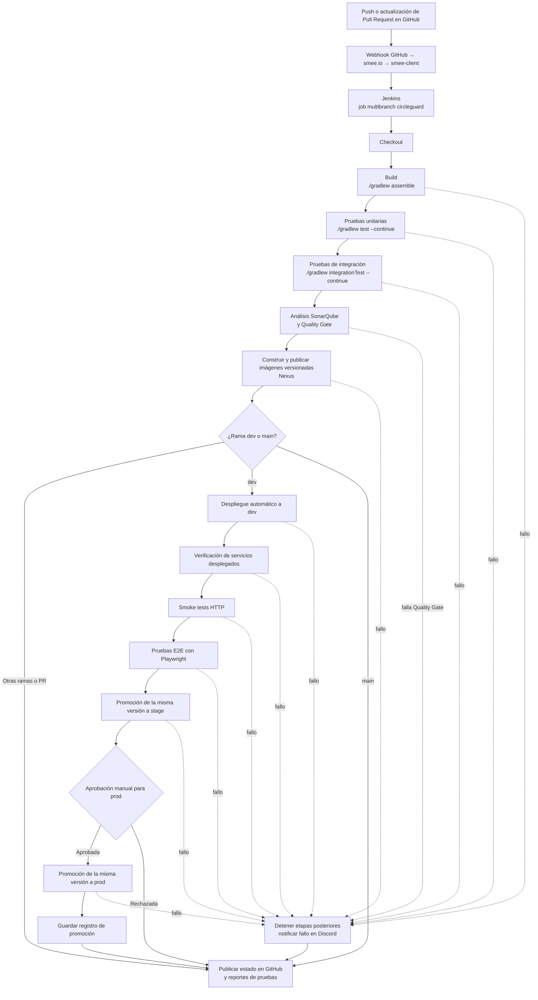

# Pipeline de CI/CD (Jenkins)

Este documento explica cómo funciona Jenkins en CircleGuard y qué ejecuta en cada build.
El despliegue, las imágenes y la promoción se detallan en [`despliegue.md`](despliegue.md);
el cálculo de versión y los tags, en [`versionado.md`](versionado.md).

Jenkins ejecuta el pipeline de CI/CD de CircleGuard.

- **Servidor:** aprovisionado con [`infra/bootstrap/jenkins`](../../infra/bootstrap/jenkins) (HU-05).
- **Configuración global y credenciales:** [`infra/config-as-code/jenkins`](../../infra/config-as-code/jenkins).
- **Job de CI:** job multibranch `circleguard`, definido en [`infra/jenkins/jobs/circleguard.xml`](../../infra/jenkins/jobs/circleguard.xml).
- **Pipeline:** librería compartida [`circleguard-jenkins-library`](https://github.com/isabellacv1/circleguard-jenkins-library),
  registrada en Jenkins como `circleguard-pipeline-library`. El [`Jenkinsfile`](../../Jenkinsfile) en la raíz
  del repositorio solo carga la librería y pasa los parámetros (HU-11).

## Librería compartida

| Configuración | Valor |
|---------------|-------|
| Nombre en Jenkins | `circleguard-pipeline-library` |
| Repositorio | `https://github.com/isabellacv1/circleguard-jenkins-library.git` (público, no requiere credenciales) |
| Versión por defecto | `main` (se puede sobreescribir con `@Library('circleguard-pipeline-library@<branch>')`) |
| Ubicación | **Manage Jenkins → System → Global Trusted Pipeline Libraries** |

`Jenkinsfile`:

```groovy
@Library('circleguard-pipeline-library@main') _

circleguardPipeline(
    integrationTests: true,
    sonar: true,
    sonarProjectKey: 'CircleGuard',
    publish: true,
    deploy: true,
    environment: 'dev',
    e2e: true,
    promote: true,
    discordCredentialsId: 'discord-webhook-url'
)
```

Los parámetros y pasos disponibles están documentados en el README de la librería. Para
conservar el registro cuando se reconstruye Jenkins, agrega el bloque `globalLibraries` de ese
README a `infra/config-as-code/jenkins/jenkins.yaml`.

## Acceso

- **URL:** `http://<jenkins-host>:8080`. El host se comparte en el canal del equipo; no se publica
  aquí porque el repositorio es público.
- **Usuario:** pide una cuenta al equipo. No compartas credenciales en el repositorio, PRs ni issues.

## Cómo se conecta con GitHub

```
GitHub (push / pull_request)
   │  webhook
   ▼
canal smee.io ──► contenedor smee-client ──► Jenkins /github-webhook/
                                                   │
                                                   ▼
                                     Job multibranch "circleguard"
                                     (escanea ramas y PRs, ejecuta el Jenkinsfile)
                                                   │
                                                   ▼
                                     Estado del build reportado a GitHub
```

| Pieza | Dónde | Notas |
|-------|-------|-------|
| Webhook de GitHub | **Settings → Webhooks** del repo | Apunta al canal smee.io del equipo. Eventos: push, pull_request, create, delete. |
| smee-client | `infra/bootstrap/jenkins/docker-compose.yml` | Reenvía el webhook a Jenkins, que no tiene endpoint HTTPS público. |
| Credencial de GitHub | Credencial de Jenkins `git-credential` | Usuario + token para leer el repositorio y reportar el estado del build a GitHub. |
| Job multibranch | Job de Jenkins `circleguard` | Definición versionada en `infra/jenkins/jobs/circleguard.xml`. |

### Configuración del job multibranch

- **Origen:** GitHub, `isabellacv1/final-project-A00401116-A00401334-A00401749-A00402018`.
- **Ramas:** solo `main` y `dev`, más los PRs (`PR-*`). El filtro del job es `main dev PR-*`;
  las ramas de feature no se construyen por separado, se validan a través de su pull request.
- **Pull requests:** PRs del mismo repositorio, construidos fusionados con su rama destino.
- **Disparadores:** el webhook inicia un build en cada push a `main`/`dev` o actualización de PR.
  Se mantiene un escaneo periódico cada 30 minutos como respaldo por si se pierde un webhook.
- **Ramas eliminadas o filtradas:** sus jobs se conservan 30 días y después se eliminan
  (`pruneDeadBranches=true`, `daysToKeep=30`).

Antes del filtro, al fusionar un PR se lanzaban dos builds: `dev` por el push y la rama de
feature, que Jenkins empezaba a construir al cerrarse el PR. Con el filtro solo corre `dev`.

### Estados reportados a GitHub

| Contexto | Cuándo |
|----------|--------|
| `continuous-integration/jenkins/branch` | Build de una rama. |
| `continuous-integration/jenkins/pr-merge` | Build de un PR fusionado con su rama destino. Obligatorio para fusionar a `dev` y `main` (HU-12). |

## Etapas del pipeline

| Etapa | Comando | Tiempo máximo |
|-------|---------|---------------|
| Checkout | `checkout scm` | - |
| Build | `./gradlew assemble` | 30 min |
| Pruebas | `./gradlew test --continue` | 45 min |
| Pruebas de integración | `./gradlew integrationTest --continue` | 30 min |
| SonarQube | análisis + quality gate | con `sonar: true` |
| Publicar imágenes | `docker build` + `docker push` a Nexus | 40 min (`publish: true`) |
| Despliegue | SSH al entorno, `docker compose pull` + `up -d --wait` | 20 min (`deploy: true`, rama en `deployBranches`) |
| Verificar despliegue | Comprobación HTTP de los seis componentes con reintentos | 15 min (`deploy: true`) |
| Smoke tests | Comprobaciones HTTP funcionales contra el host destino | 10 min (`deploy: true`) |
| Pruebas E2E | Playwright en un contenedor contra `dev` desplegado | 20 min (`e2e: true`) |
| Promover a stage | Despliega la **misma versión** a `stage` y la verifica | 240 min (`promote: true`) |
| Promover a prod | Igual, pero siempre detrás de una aprobación manual (`input`) | 240 min (`promote: true`) |

> Las etapas de despliegue, verificación, smoke tests, E2E y promoción solo se ejecutan en la
> rama `dev` (`deployBranches`). En `main` el pipeline construye, prueba, analiza y publica
> imágenes, pero no despliega.

### Diagrama del pipeline



El `Jenkinsfile` habilita pruebas de integración, SonarQube, publicación,
despliegue, E2E y promoción. La publicación se limita a `dev` y `main`; solo `dev`
se despliega automáticamente. Las etapas posteriores dependen del éxito de las
anteriores. La promoción a producción requiere aprobación manual.

### Promoción de versiones (HU-14)

```
push dev ─► Build ─► Pruebas ─► Integración ─► SonarQube ─► Publicar imágenes
      └► Desplegar dev ─► Verificar dev ─► Smoke tests ─► Pruebas E2E
                                │
                                ▼  (solo si todas las validaciones anteriores pasaron)
                         Promover a stage   ← automático, misma versión de imagen
                                │
                                ▼
                         Promover a prod    ← aprobación manual con `input`
                                │
                                ▼
                  promotion-record.txt (archivado con el build)
```

- **Condiciones:** solo se llega a una promoción cuando el build, las pruebas unitarias, las
  pruebas de integración, el despliegue del entorno anterior, sus smoke tests y las pruebas E2E
  están en verde; `Promover a prod` además requiere una aprobación humana que Jenkins registra
  en el log del build.
- **Versión identificable:** cada promoción despliega `env.IMAGE_VERSION`, la versión semántica
  publicada por este mismo build (nunca `latest`).
- **Evidencia:** cada promoción agrega una entrada a `promotion-record.txt` (versión, ruta,
  aprobador, fecha y URL del build) y el archivo se archiva como artefacto del build.

El despliegue descarga las imágenes publicadas por el mismo build (versión semántica, nunca
`latest`) desde `100.31.132.57:8082` y lee la configuración del entorno desde
[`deploy/environments`](../../deploy/environments). Solo la rama `dev` despliega
automáticamente; `stage` y `prod` se promueven en el flujo de promoción de versiones. Ver
[`deploy/README.md`](../../deploy/README.md).

Después de cada ejecución, incluso si una etapa falla, Jenkins publica los resultados JUnit y
archiva los reportes de pruebas y de cobertura JaCoCo. Los benchmarks de rendimiento no forman
parte del pipeline; se ejecutan con `./gradlew performanceTest`.

Cuando un build falla, la librería compartida envía un mensaje a Discord con el job, el número
de build, la rama, el commit y la URL del build. La URL del webhook se guarda en Jenkins como
una credencial de tipo **Secret text** con id `discord-webhook-url` (configurada por
`infra/config-as-code/jenkins/configure-jenkins.sh` o manualmente en **Manage Jenkins →
Credentials**). Las imágenes se etiquetan con la versión semántica resuelta a partir de los
tags de Git (ver [versionado.md](versionado.md)), nunca con `latest`.

### Testcontainers dentro de Jenkins

Jenkins se ejecuta en un contenedor y usa el daemon Docker del host a través de
`/var/run/docker.sock`, por lo que los contenedores que inicia Testcontainers son hermanos de
Jenkins, no hijos. Solo son alcanzables a través del gateway de la red `bridge` del host. El
paso de librería `configureTestcontainers()` define `TESTCONTAINERS_HOST_OVERRIDE` con ese
gateway antes de ejecutar las pruebas.

### Recursos

El pipeline y las pruebas con Testcontainers necesitan memoria y disco. Con 1 GB de RAM y 14 GB
de disco los builds tardaban más de 40 minutos y Jenkins sacaba al nodo de línea cuando el
espacio libre bajaba de 1 GB. Con 8 GB de RAM un build completo tarda unos 7 minutos. Si el
nodo queda fuera de línea por falta de espacio, límpialo con `docker system prune -af` en el
host.

## Ejecutar el pipeline

- **Automáticamente:** haz push a `main` o `dev`, o abre/actualiza un PR. El build comienza en
  pocos segundos.
- **Manualmente:** abre el job `circleguard`, selecciona la rama o el PR y haz clic en
  **Build Now**.
- **Reescanear ramas:** en el job `circleguard` haz clic en **Scan Repository Now** (útil
  después de crear una rama `main`/`dev` o si el webhook no llegó).

## Leer los resultados

- **Stage view:** muestra qué etapa falló.
- **Pestaña Tests:** resultados JUnit de cada servicio, con las pruebas fallidas y sus stack traces.
- **Build Artifacts:** reportes HTML de pruebas y reportes de cobertura JaCoCo de cada servicio.
- **GitHub:** el estado del build se muestra en el commit y en los checks del PR.

## Recrear el job

Si Jenkins se reconstruye, crea el job de nuevo desde la definición versionada:

```bash
JENKINS_URL=http://<jenkins-host>:8080
CRUMB=$(curl -s -c cookies -u <user>:<token> "$JENKINS_URL/crumbIssuer/api/json" \
  | python3 -c "import json,sys;d=json.load(sys.stdin);print(d['crumbRequestField']+':'+d['crumb'])")
curl -s -b cookies -u <user>:<token> -H "$CRUMB" -H "Content-Type: application/xml" \
  -X POST --data-binary @infra/jenkins/jobs/circleguard.xml "$JENKINS_URL/createItem?name=circleguard"
```

La credencial `git-credential` y la librería compartida `circleguard-pipeline-library` deben
existir en Jenkins antes de ejecutar el job. Luego haz clic en **Scan Repository Now** en el job.
