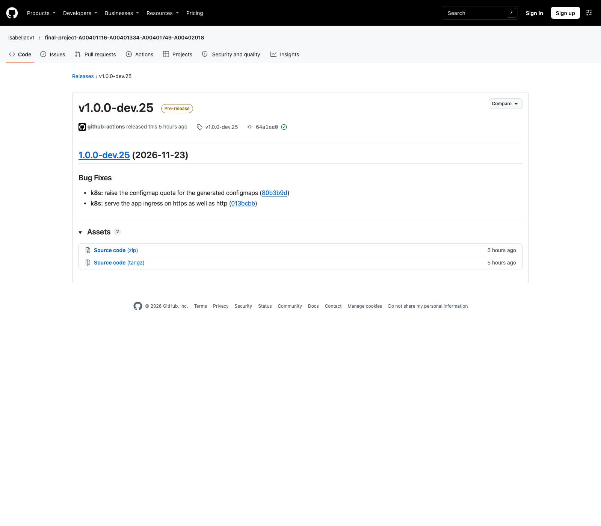

# Release notes and GitHub Releases

Every version created by the automatic semantic versioning (HU-18, semantic-release) is published as a
**GitHub Release** with **release notes generated from the commits**. Nobody writes release notes by
hand.

This part only configures the notes and the publication of the release. The version calculation, the
tags and the workflow that runs semantic-release are part of HU-18 (see [`versionado.md`](versionado.md)).

| File | Purpose |
|------|---------|
| [`.releaserc.json`](../../.releaserc.json) | `release-notes-generator` (notes) and `@semantic-release/github` (GitHub Release) plugins. |

## Release notes

The notes are generated from the Conventional Commits included in the version and grouped in sections:

| Commit type | Section |
|-------------|---------|
| `feat` | Features |
| `fix` | Bug Fixes |
| `perf` | Performance |
| `revert` | Reverts |
| `refactor` | Refactoring |
| `test` | Tests |
| `ci` | CI/CD |
| `build` | Build |
| `docs` | Documentation |
| `chore`, `style` | hidden |

Every entry shows the commit message (and scope, if any) with a link to the commit. Breaking changes
are listed in their own section.

Example:

```markdown
## 1.1.0 (2026-11-10)

### Features
* **promotion:** add status cascade with 14-day ttl (a1b2c3d)

### Bug Fixes
* **gateway:** correct signed qr expiration (d4e5f6a)
```

## GitHub Releases

- Each version is published under **Releases** (`/releases`) with its tag and its notes.
- Versions from `main` are normal releases; versions from `dev` (`X.Y.Z-dev.N`) are marked as
  pre-releases.
- No comments or labels are added to the PRs and issues included in a release.
- No `CHANGELOG.md` is committed back to the branches, because `main` and `dev` only accept changes
  through pull requests. The history lives in the GitHub Releases.

## Tips for useful notes

- Write the commit subject as a short description of the change, it is copied as is into the notes.
- Merge PRs with **Create a merge commit** so the individual commits reach the notes. If a PR is
  squashed, the squash message must follow the convention.

## Acceptance criteria → evidence (HU-19)

| Criterion | Evidence |
|-----------|----------|
| Every version has release notes generated from the commits | **25 GitHub Releases** published by semantic-release: `v1.0.0` (main, 2026-11-09) and the `v1.0.0-dev.N` pre-releases from `dev`. Each one groups the commits by type (Features, Bug Fixes…) with links to the commits. |
| The release is published automatically | Created by `github-actions` when `dev` or `main` receives a merge; nobody edits the notes by hand. |
| Pre-releases are distinguished from releases | Versions from `dev` are marked **Pre-release** (`1.0.0-dev.25`), versions from `main` are normal releases (`1.0.0`). |

`v1.0.0-dev.25`, generated from the two fixes merged in PR #52:


