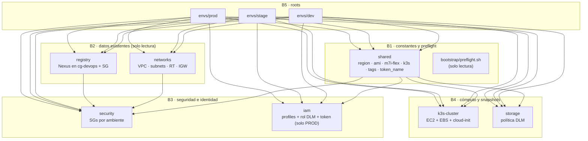

# CircleGuard — Infraestructura como código con Terraform (HU 1)

Este directorio describe la infraestructura de CircleGuard en **Terraform**: módulos
reutilizables y tres estados independientes (DEV, STAGE, PROD) que consumen esa
red compartida y la infraestructura existente de la Parte 1 **sin modificarla**.

> **Estado de ejecución:** este documento describe la configuración y el
> procedimiento. **Ningún `init`, `plan` ni `apply` se ha ejecutado todavía**:
> los recursos "nuevos" están *declarados*, no creados. Todo lo marcado como
> *existente* sí fue verificado en la cuenta con consultas de solo lectura.

---

## 1. Objetivo y alcance

- **Objetivo (HU 1):** describir la infraestructura de CircleGuard con archivos
  Terraform, parametrizar sus configuraciones por ambiente, permitir revisar el
  plan de ejecución, aprovisionar los recursos con `apply` y documentar el proceso.
- **Dentro del alcance:** red (solo lectura), Security Groups, identidad/perfiles
  IAM, nodos k3s (EC2 + EBS + cloud-init), snapshots EBS con DLM, registro Nexus
  representado como dato, y los tres roots por ambiente.
- **Fuera del alcance (HU 2):** backend remoto (S3), bloqueo de estado con
  DynamoDB, detección de *drift*, procedimientos de `destroy` y pipeline de
  `terraform plan/apply` en Jenkins.

---

## 2. Arquitectura general y separación de ambientes

Un **estado por ambiente** (carpeta `envs/<ambiente>`), sin recursos compartidos
entre estados: cada uno declara exactamente los recursos de su ambiente, con
nombres que llevan el ambiente (`cg-k3s-<env>-*`, `cg-dlm-<env>-role`,
`cg-snapshots-<env>`), de modo que dos estados jamás compiten por un nombre.



| Ambiente | Topología | Parameter Store |
|---|---|---|
| **DEV** | 1 nodo server, sin agent | no usa |
| **STAGE** | 1 nodo server, sin agent | no usa |
| **PROD** | 1 nodo server **+ 1 nodo agent** | **único que usa**: server publica el token de unión, agent lo lee |

---

## 3. Estructura de directorios

```
infra/terraform/
├── README.md                     # este documento
├── bootstrap/
│   └── preflight.sh              # verificación previa de solo lectura (B1)
├── shared/                       # constantes compartidas, sin recursos (B1)
│   ├── main.tf                   #   region, ami, instance_type, k3s_version, tags, token name
│   └── outputs.tf                #   se leen como module.shared.<salida>
├── modules/
│   ├── networks/                 # B2 · data sources de la red existente
│   ├── registry/                 # B2 · data source de Nexus en cg-devops
│   ├── security/                 # B3 · SGs nuevos + reglas separadas
│   ├── iam/                      # B3 · roles/profiles + rol DLM + token (PROD)
│   ├── storage/                  # B4 · política DLM de snapshots
│   ├── k3s-cluster/              # B4 · EC2 + EBS + cloud-init
│   │   └── templates/            #   server/agent-cloud-init.yaml.tftpl
│   └── observability/            # vacío: se implementará en E2.5 (fuera de HU 1)
└── envs/
    ├── dev/                      # root DEV   (B5)
    ├── stage/                    # root STAGE (B5)
    └── prod/                     # root PROD  (B5)
        ├── versions.tf           #   required_version / required_providers
        ├── providers.tf          #   provider "aws" { region = var.aws_region }
        ├── main.tf               #   cableado de los7 módulos + check de región
        ├── variables.tf          #   aws_region, key_name, root_volume_size, agent_count
        ├── outputs.tf            #   14 salidas por ambiente (sin secretos)
        └── terraform.tfvars      #   valores específicos del ambiente (versionado)
```

Cada módulo tiene una responsabilidad única: **no crean recursos "de utilidad
general" ceremoniales**; `networks` y `registry` solo leen, `observability` está
vacío a propósito (E2.5).

---

## 4. Recursos principales (declarados; aún NO creados)

Estos recursos **se crearán con `terraform apply`** (no existen en AWS hoy):

| Módulo | Recursos declarados | Nombres / valores reales |
|---|---|---|
| `security` | `aws_security_group` + `aws_vpc_security_group_ingress_rule` / `aws_vpc_security_group_egress_rule` | `cg-k3s-dev-sg`, `cg-k3s-stage-sg`, `cg-k3s-prod-server-sg`, `cg-k3s-prod-agent-sg` |
| `k3s-cluster` | `aws_instance` (server ×1 por ambiente; agent ×1 solo en PROD) | `m7i-flex.large`, AMI `ami-08b275ac6cc5dbefb` (Ubuntu24.04 noble amd64, build20261108, Canonical `099720109477`), IMDSv2 obligatorio, `monitoring=false`, IP pública explícita |
| `k3s-cluster` | `root_block_device` (EBS por nodo) | gp3 **cifrado**, `delete_on_termination=true`: DEV40 GB, STAGE40 GB, PROD 50 GB ×2, con tags `Project`/`Environment`/`DailySnapshot` |
| `iam` | `aws_iam_role` + `aws_iam_role_policy_attachment` + `aws_iam_instance_profile` | `cg-k3s-<env>-server-role/-profile`, `cg-k3s-prod-agent-role/-profile`; `AmazonSSMManagedInstanceCore` en todos |
| `iam` | `aws_iam_role_policy` (inline, **solo PROD**) | `cg-k3s-prod-server-token-put` → `ssm:PutParameter` sobre el ARN exacto; `cg-k3s-prod-agent-token-get` → `ssm:GetParameter` sobre el ARN exacto |
| `iam` | `aws_iam_role` DLM + attachment | `cg-dlm-<env>-role`, trust `dlm.amazonaws.com`, política `AWSDataLifecycleManagerServiceRole` (snapshots; **no** la de AMI) |
| `storage` | `aws_dlm_lifecycle_policy` | schedule `diario-0300-utc` (`times = ["03:00"]` **UTC**), retención **7**, `resource_types = ["VOLUME"]`, `target_tags = {Project, Environment, DailySnapshot}` |
| (al arrancar) | parámetro SSM **SecureString** | `/circleguard/k3s/prod-join-token` — lo crea el server de PROD con cloud-init (no Terraform) |

**Versiones fijadas (sin `latest`):** Terraform `>=1.6.0,<2.0.0` · provider
`hashicorp/aws ~> 6.72` · k3s **`v1.37.2+k3s1`** · AWS CLI v2 **`2.40.3`** con
SHA256 `4770c06c4ecfc8ba94b60d89e6c7018ab7ea2cf5341b1ef05f6f93c5d6e8b705`
(verificado con la firma GPG de "AWS CLI Team"), instalado por el bootstrap
**solo donde Parameter Store se usa**.

---

## 5. Recursos existentes que se consultan o reutilizan (solo lectura)

Terraform **no administra ni modifica** nada de esta lista; se consume con
`data` sources o referencias:

| Recurso | Cómo se obtiene | Verificación |
|---|---|---|
| VPC `circleguard-vpc` (`10.20.0.0/16`) | `networks` (filtro `tag:Name` + CIDR) | diagnóstico previo + preflight |
| Subredes `cg-dev-subnet`, `cg-stage-subnet`, `cg-prod-subnet`, `cg-devops-subnet` (todas en `us-east-1a`) | `networks` (filtro por nombre) | ídem |
| Tabla de rutas `circleguard-public-rt` + ruta `0.0.0.0/0 → IGW` | `networks` | ídem |
| Internet Gateway adjunto | `networks` | ídem |
| Instancia `cg-devops` (Jenkins/Nexus/SonarQube) y su SG `cg-devops-sg` | `registry` (por `tag:Name`) → exporta `security_group_ids` | diagnóstico |
| Key pairs `cg-dev-key`, `cg-stage-key`, `cg-prod-key` | referenciados por nombre en cada root (`key_name`) | preflight |
| Registro Nexus `http://<ip-privada-cg-devops>:8082` (hoy `10.20.1.230:8082`) | `registry` (`registry_endpoint`, `registry_scheme`, `registry_port`) | inspección B4 (registry v2, hosted, lectura anónima) |
| Rol `CircleGuard-EC2-SSM-Role` | **no se usa** en esta HU; queda intacto | diagnóstico |
| Identidad de la cuenta (`aws_caller_identity`) | `iam` para componer el ARN del parámetro | — |

---

## 6. Parámetros y variables por ambiente

### 6.1 Entradas por root (`variables.tf` + `terraform.tfvars`)

| Variable | DEV | STAGE | PROD | Origen |
|---|---|---|---|---|
| `aws_region` | `us-east-1` | `us-east-1` | `us-east-1` | default (validado contra `shared.region` por un `check`) |
| `key_name` | `cg-dev-key` | `cg-stage-key` | `cg-prod-key` | tfvars (key pairs existentes) |
| `root_volume_size` | 40 | 40 | 50 | tfvars |
| `agent_count` | 0 | 0 | 1 | tfvars |
| `token_parameter_name` | *omitido (null)* | *omitido (null)* | `/circleguard/k3s/prod-join-token` | `shared` (solo PROD) |

### 6.2 Constantes compartidas (`shared/`)

`region = us-east-1` · `ami_id = ami-08b275ac6cc5dbefb` · `instance_type =
m7i-flex.large` · `k3s_version = v1.37.2+k3s1` · `ssh_user = ubuntu` ·
`common_tags = {Project=circleguard, ManagedBy=terraform, Part=2, HU=HU-1}` ·
`token_parameter_name = /circleguard/k3s/prod-join-token`.

### 6.3 Valores por defecto de módulos (definidos en el módulo, no se repiten en los roots)

| Módulo | Default | Valor |
|---|---|---|
| `storage.schedule_time` | `schedule_time` | `03:00` (UTC) |
| `storage.retention_count` | `retention_count` | `7` snapshots |
| `k3s-cluster.awscli_version` / `awscli_sha256` | versión + hash fijados | `2.40.3` / `4770c06c…8b705` |
| `security.name_prefix`, `registry.instance_name`, … | `cg-k3s`, `cg-devops` | según diseño |

---

## 7. Requisitos previos

1. **Terraform `>= 1.6.0, < 2.0.0`** (los módulos usan `check`, *preconditions*,
   `startswith`, `one()`). Si no está instalado, instalarlo requiere
   autorización explícita del responsable del entorno.
2. **Proveedor** `hashicorp/aws ~> 6.72` (se descarga en `init`; la versión
   exacta quedará registrada en `.terraform.lock.hcl`, que debe versionarse).
3. **Credenciales AWS** con acceso a la cuenta `718875641310`, región
   `us-east-1` (cadena estándar: `aws configure` / variables de entorno / rol
   asumido). **Nunca** en el repositorio: no hay `.env` ni claves en estos
   archivos (verificado por escaneo).
4. Ejecutar primero el preflight (solo lectura):
   ```bash
   ./infra/terraform/bootstrap/preflight.sh
   ```
   Valida: identidad, AMI, VPC/subredes/RT/IGW, `cg-devops` + SG, key pairs,
   cuota de vCPU, ausencia de colisiones `cg-*` y permisos del operador.

## 8. Credenciales y permisos AWS (sin secretos)

- **Identidad verificada en el preflight:** usuario `cg-santi`
  (`arn:aws:iam::…:user/cg-santi`) con `AdministratorAccess` vía el grupo
  `CircleGuard-Admins`; la simulación de `simulate-principal-policy` devolvió
  `allowed` para las acciones del preflight
  (`ec2:CreateSecurityGroup`, `ec2:AuthorizeSecurityGroupIngress/Egress`,
  `ec2:CreateVpcSecurityGroupIngressRule/EgressRule`, `ec2:RunInstances`,
  `ec2:CreateTags`, `iam:PassRole`, `dlm:CreateLifecyclePolicy`).
- **Mínimo estimado para ejecutar el ciclo completo** (derivado de los recursos
  declarados, a confirmar con una política acotada en el futuro): `ec2:*`
  (describe + crear SG/reglas/instancias/volúmenes), `iam:*` (crear roles,
  perfiles, adjuntar políticas y `PassRole` restringido a los roles
  `cg-k3s-*`/`cg-dlm-*`), `dlm:*` y `ec2:CreateTags`, además de permisos de
  lectura para los `data` sources (`ec2:Describe*`, `sts:GetCallerIdentity`).
- **Los roles de instancia no usan `AdministratorAccess`**: solo
  `AmazonSSMManagedInstanceCore` (+ en PROD las dos políticas inline de
  parámetro sobre el ARN exacto). **Sin permisos KMS**.
- **Los nodos** reciben credenciales solo por *instance profile*; el bootstrap
  instala AWS CLI v2 fijado con SHA256 **solo donde Parameter Store se usa**
  (PROD).

---

## 9. Comandos esperados (instrucciones; NO ejecutados)

```bash
#0) Preflight (solo lectura) — antes de todo
./infra/terraform/bootstrap/preflight.sh

#1) Inicializar un ambiente (genera .terraform/ y .terraform.lock.hcl → versionar)
terraform -chdir=infra/terraform/envs/dev init

#2) Revisar el plan (guardarlo como evidencia)
terraform -chdir=infra/terraform/envs/dev plan -out=tfplan

#3) Aplicar SOLO tras revisar el plan (PROD requiere aprobación humana)
terraform -chdir=infra/terraform/envs/dev apply tfplan

#4) Consultar salidas
terraform -chdir=infra/terraform/envs/dev output
terraform -chdir=infra/terraform/envs/dev output -json
```

**Orden recomendado:** `dev` → `stage` → `prod`, un ambiente a la vez, con el
preflight en verde antes de cada `init`. **Precauciones (estado local, HU 2):**
no hay backend remoto todavía → el `*.tfstate` vive en la máquina del operador
(ya está en `.gitignore`); una sola persona debe aplicar por ambiente a la vez;
hacer copia del estado antes de cambios arriesgados. Nunca ejecutar comandos
que no estén documentados aquí.

## 10. Outputs relevantes

Cada root expone **14 salidas** (sin secretos):

`environment`, `subnet_id`, `server_instance_id`, `server_private_ip`,
`server_public_ip`, `agent_instance_id`, `agent_private_ip`, `agent_public_ip`
(**null** en DEV/STAGE), `node_names`, `root_volume_ids`, `server_sg_id`,
`agent_sg_id`, `dlm_policy_id`, `registry_endpoint`.

Consulta: `terraform -chdir=infra/terraform/envs/<ambiente> output <nombre>`
(o `output -json` para todo). El token de unión **nunca** aparece en outputs,
variables, `tfvars` ni en el estado de Terraform (nace dentro de la instancia).

---

## 11. Consideraciones de seguridad

| Control | Implementación |
|---|---|
| **IAM mínimo** | Roles por ambiente sin privilegios administrativos; `Parameter Store` **solo en PROD** con permisos sobre el **ARN exacto** del parámetro; sin `kms:*`; rol existente `CircleGuard-EC2-SSM-Role` intacto |
| **Security Groups** | Nuevos y restrictivos: `22`/`6443` solo desde `cg-devops-sg`; `80/443` públicos **solo** en el server de PROD (DEV/STAGE solo desde `cg-devops-sg`); internos `6443/8472/10250` solo entre server/agent de PROD; egress E1–E5 (DNS del VPC *declarativo* — AWS no filtra ese tráfico con SG —, `443`, `80`, `123` y `8082` hacia el SG del registro). Sin NodePorts ni etcd expuestos |
| **IMDSv2** | `http_tokens = "required"` en las cuatro instancias; cloud-init usa el *token dance* de IMDSv2 |
| **Cifrado EBS** | gp3 con `encrypted = true` (la cuenta no tiene cifrado por defecto) y `delete_on_termination = true` |
| **Token de k3s (PROD)** | SecureString en Parameter Store; publicación con `--value file://` (el valor no pasa por argv ni por logs), lectura con `GetParameter --with-decryption` redirigida a fichero `0600`, unión con `--token-file`, sin `set -x`, sin `K3S_TOKEN` en el entorno, temporales limpiados con `trap` |
| **SSH / acceso** | Solo desde `cg-devops-sg`; SSM Session Manager como alternativa preferida |
| **Registro Nexus** | HTTP sin TLS temporalmente (deuda documentada): `registries.yaml` declara el endpoint `http://` de la IP privada; sin credenciales en cloud-init ni Terraform |
| **Secretos en Git** | Escaneo sin coincidencias (`AKIA…`, claves, passwords, tokens); `tfvars` solo contienen `key_name`, `root_volume_size`, `agent_count` |

---

## 12. Dependencias y limitaciones conocidas

**Dependencias:** B1→B2→B3→B4→B5 (este README los documenta); el `storage`
depende de `iam.dlm_role_arn` y de la **convención de tags** de
`k3s-cluster`; el agent de PROD depende del server (IP privada) y del parámetro
SSM; `one(module.registry.security_group_ids)` exige que `cg-devops` tenga
**exactamente un** SG.

**Limitaciones conocidas:**

1. **Nada ejecutado:** sin `init`, `plan` ni `apply`; el comportamiento real
   (cloud-init, k3s, DLM, pulls de Nexus) está **pendiente de verificación**.
2. **Estado local sin backend** (HU 2 agregará S3 + DynamoDB + lock).
3. **Una sola AZ** (`us-east-1a`) y **PROD sin HA** de plano de control
   (1 server + 1 agent): limitación conocida y documentada.
4. **Nexus por HTTP** y **sin pull-through de Docker Hub** (imágenes de Hub van
   directo a internet, permitido por el egress).
5. **`get.k3s.io`** es un script servido por HTTPS sin fijar (la *versión* de
   k3s sí está fijada); posible mejora: binario con `sha256`.
6. `user_data_replace_on_change` queda en `false`: cambios de plantilla no
   recrean nodos (rebuild explícito si hace falta).
7. Verificaciones **post-apply pendientes**: instancia registrada en SSM
   (`ssm describe-instance-information`), AWS CLI v2 en la AMI, `k3s get nodes`,
   pull real desde containerd hacia Nexus y primer snapshot de DLM.
8. `preflight.sh` parsea `shared/main.tf` con `sed`: si se reformatea ese
   archivo, el preflight debe actualizarse.
9. La región está declarada en `shared.region`, en `var.aws_region` de los
   roots y en el preflight: el `check "aws_region_vs_shared"` detecta
   discrepancias en el primer plan.

---

## 13. Procedimiento de uso por ambiente

**Común (una vez):** `./infra/terraform/bootstrap/preflight.sh` en verde.

**DEV:** `terraform -chdir=infra/terraform/envs/dev init` → `plan -out=tfplan`
→ **revisar el plan** (esperado: solo creaciones; cero destrucciones) →
`apply tfplan` → `output` → verificación post-apply (§12.7).

**STAGE:** ídem con `envs/stage`.

**PROD:** ídem con `envs/prod`, con **aprobación humana explícita antes del
`apply`**. Tras aplicar: verificar que el server publicó el parámetro
SecureString (`aws ssm get-parameter --name /circleguard/k3s/prod-join-token
--with-decryption` sólo por personal autorizado) y que el agent se unió
(`k3s get nodes` vía SSM). Nunca mostrar el valor del token en canales
compartidos.

**Verificación de salud (solo lectura):** `./scripts/check-infrastructure.sh`
(documentado en `docs/operaciones/infraestructura.md`).

**Destrucción:** fuera del alcance de HU 1 (procedimientos de `destroy` y
apagado de recursos pertenecen a HU 2 / cierre del proyecto).
